# Vibe Coding Lab

A collection of browser-based experiments. Unfinished, undocumented, weird stuff. Each experiment is a self-contained HTML file -- just open it in a browser, no build step needed.

Browse the gallery at [index.html](index.html), or jump straight to the highlights below. The [full list](#all-experiments) is further down.

## Highlights

### A Real Stab at the Riemann Hypothesis

A browser laboratory that builds the zeta function from scratch in double precision, hunts zeros of Hardy's Z(t) live, audits them Turing-style, plays the primes against the zeros through Weil's explicit formula, and dissects the machinery of the 2026 "two thirds of zeros are simple and on the line" result. The engine self-tests on the page before it computes anything, and since September 2026 the page also runs Lamzouri's matrix-free second proof of the same constants against its own zeros. The `dev/` folder holds the numerical research program behind it, with interval-arithmetic checkers and a research note that is honest about what is proven and what is only observed.

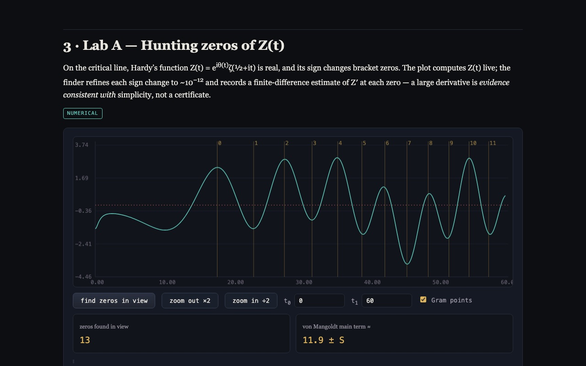

### Atlas of Computational Building Blocks

A single-page reference atlas of 263 computational ideas across algorithms, data structures, systems, cryptography, ML, optimization, robotics, databases, geometry and compression. Each entry carries prerequisites, invariants and failure modes; the whole thing is filterable like a periodic table, and an audit script keeps the dataset consistent.

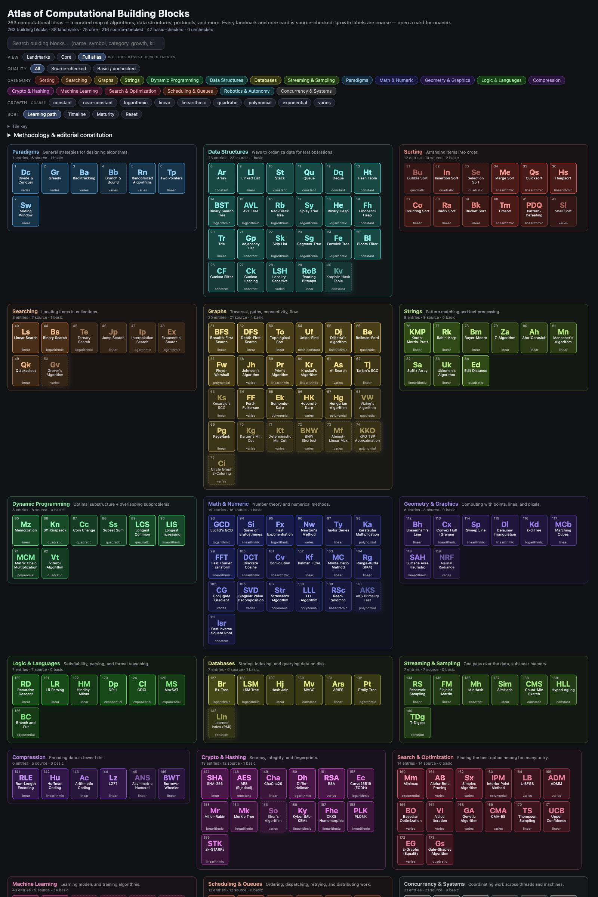

### Forward-Forward Binary Language Model

Hinton's Forward-Forward algorithm training a byte, bigram or trigram next-token model in the browser. No backprop, no GPU. Train, pause, sample from the current weights, resume. Muon, Adam and SGD optimizers to compare.

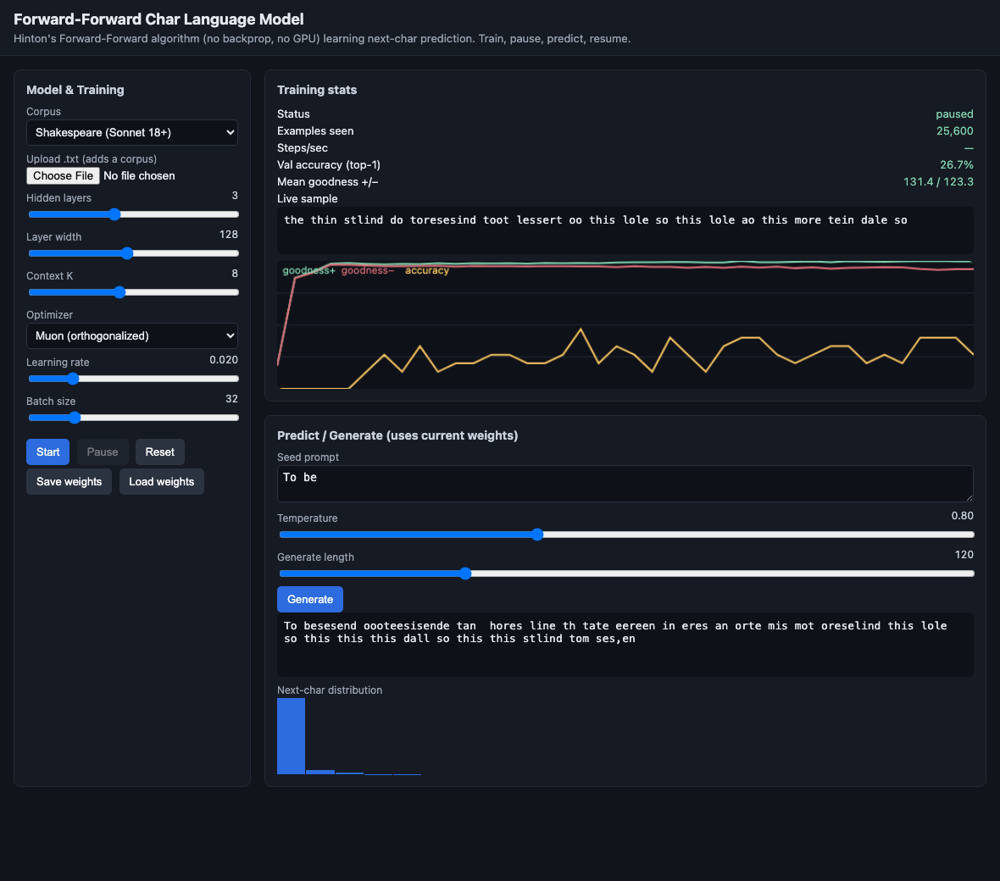

### Negative-Weight Shortest Paths in Near-Linear Time

A step-by-step visualisation of the Bernstein, Nanongkai and Wulff-Nilsen 2022 algorithm for single-source shortest paths with negative edge weights. Watch the low-diameter decomposition, the price functions and the recursion unfold on an SVG graph.

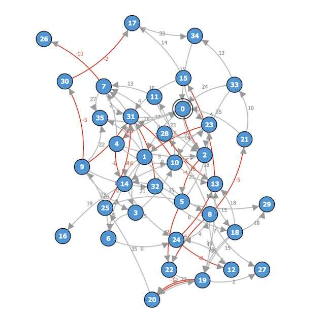

### Torus Shooter

Amiga-demo-style two-player shooter on a torus. Shots stick, bounce or carve holes clean through the surface. Split-screen with an exterior view and a first-person interior view of the same signed-distance field. Hand-written WebGL ray marching with CSG, no engine.

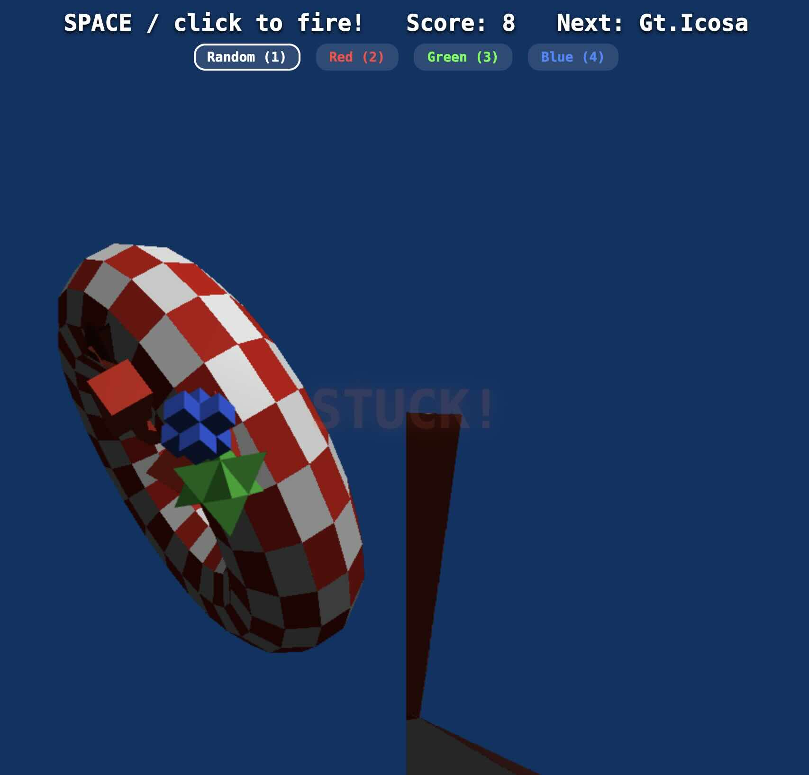

### Wrecking Ball

Swing a crane-hung wrecking ball into a stone castle, a Mesoamerican pyramid, a wooden Trojan horse or a red-brick apartment block, all generated block by block. A mortar-bond model cracks blocks loose under impact and drops whatever loses its footing. Grab the ball on its chain with the mouse, drive the crane with the keys, synthesised thuds, clatter and crane motor. Three.js + Rapier.

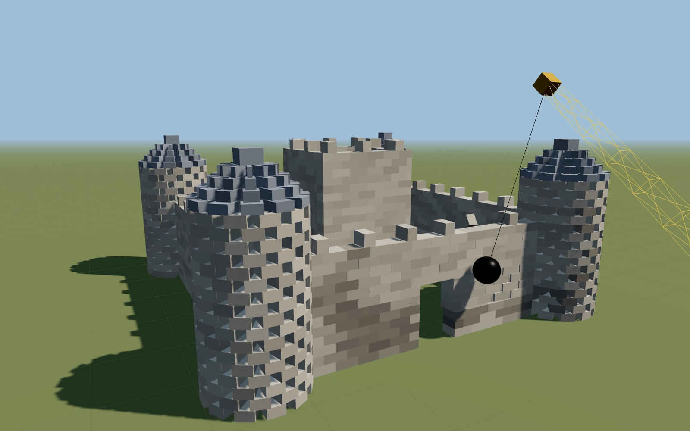

### Stair Dismount

A homage to Porrasturvat's Stair Dismount. A ragdoll stands on top of a straight flight, a dogleg, a spiral or a long walled staircase. Click a spot on the body, aim the arrow, choose the force and push; every impact on the way down scores, head hits most. Retry replays the exact push. Synthesized screams, thuds and grunts, M to mute. Three.js + Rapier.

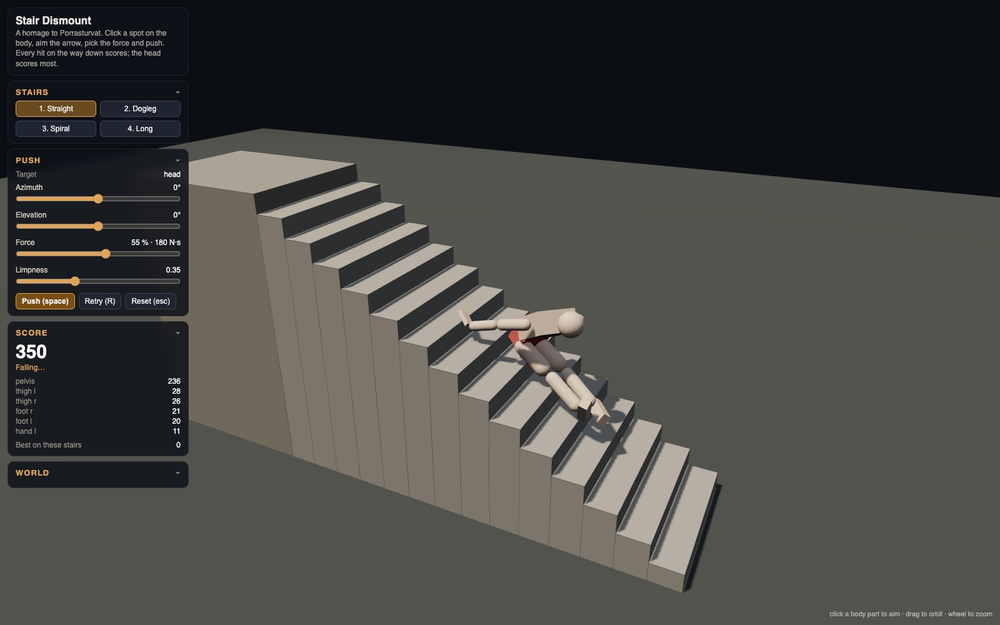

### Snake MCTS

Browser port of [SwiftSnakeEngine](https://github.com/neoneye/SwiftSnakeEngine), a two-player snake puzzle with a Monte Carlo tree search opponent running in a Web Worker. Shows the bot's planned path, supports undo, and ships a tournament harness for pitting bot configurations against each other in Node.

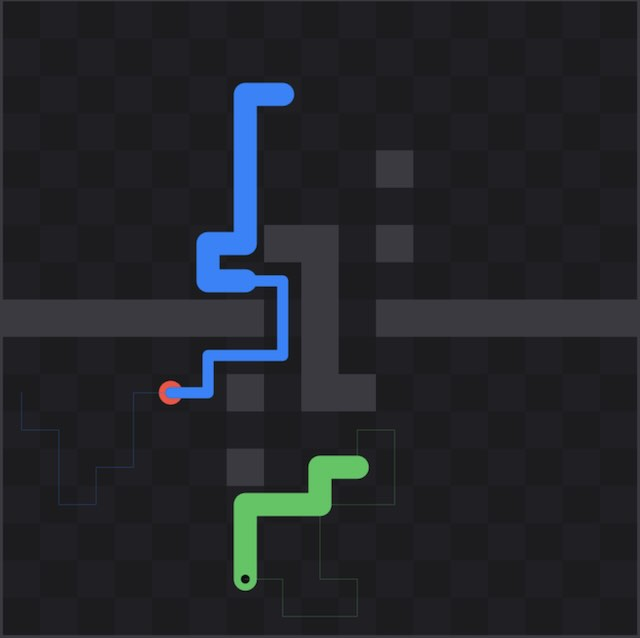

### Basement, Sublevel K

A Wolfenstein-style raycaster horror game with VHS post-processing. Every texture, sprite and sound is generated in code at load time; the single HTML file has no assets at all.

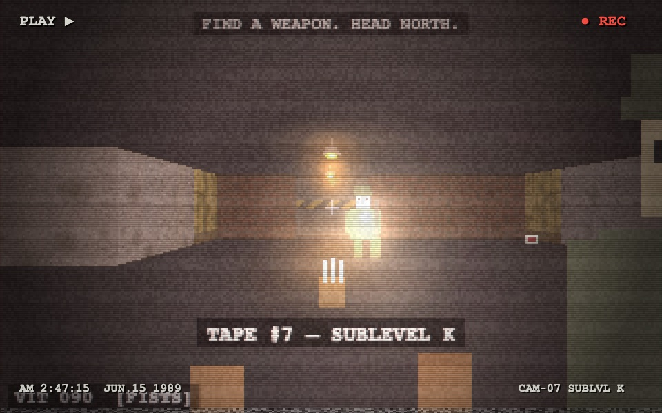

### Pulleys

Drag pulleys from the tray onto the beam or the hook, or start from a ready-made rig, then haul on the rope. Computes mechanical advantage and rope pull, lets the load swing on its sling and the wind push on it, and if you hang a unicorn from the hook its jointed legs dangle, its mane trails, and its horn will eventually snap off.

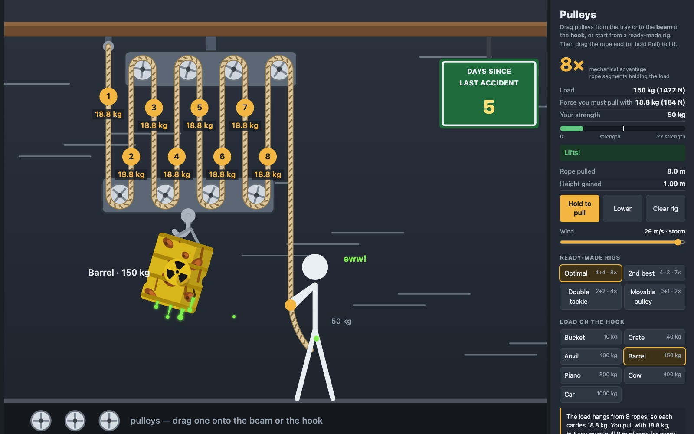

### Audio Singularity

Black holes, a bouncing ball, a spinning disk and the AI singularity are the same shape: something diverges at a finite time. This page makes that shape audible as chirps and event swarms, with plots to match and WAV export. Web Audio.

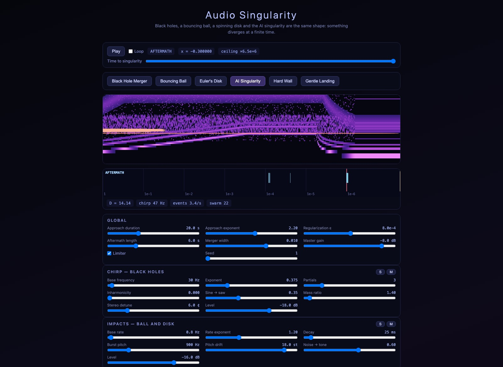

### 1927 Solvay Conference

The famous group photo with a clickable circle over each of the 29 attendees, linking to their Wikipedia pages. Face positions were found offline with OpenCV's YuNet detector.

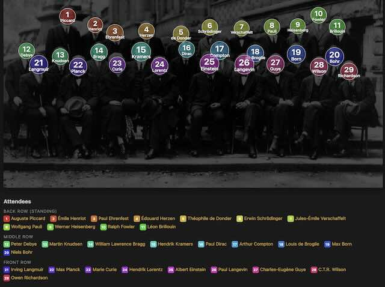

### The Pythagorean Cup

The greedy cup, cut open and explained. A guided tour, a pressure view along the siphon path, and free-play pouring on top of a small one-dimensional hydraulics model. SVG.

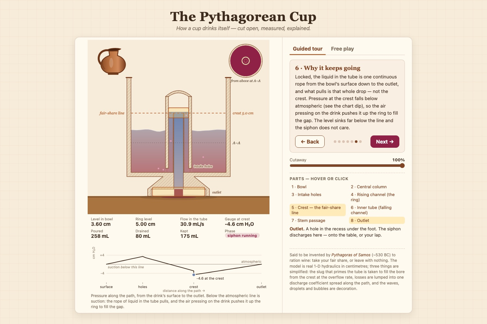

### Spinor Belt Trick

Dirac's belt trick: a 360 degree turn leaves a twist, 720 degrees undoes it. A scrubbable quaternion homotopy shows why. Three.js.

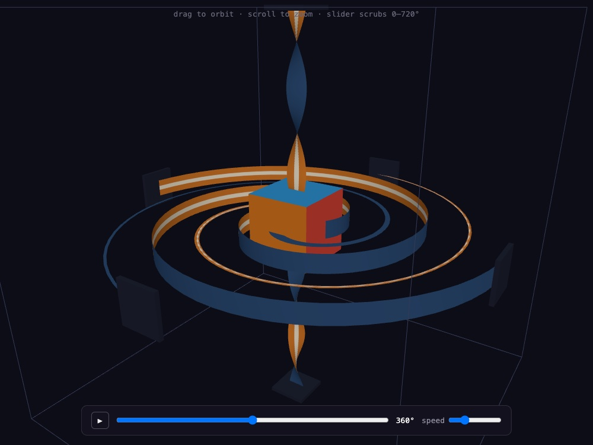

## All experiments

### 2D simulations and visualisations

- [asphalt](asphalt/) -- a drawing program in hot mix. Shovel lumpy asphalt onto a gravel base or lay an even mat with the paver, rake it, and roll it flat before it cools. Each 5 mm cell keeps a stack of layers with thickness, air voids and temperature: thin lifts cool faster, rolling only compacts above about 80 °C and cracks cold mix, hot mix is shoved ahead of the drum. Place cold lumps, big stones, puddles that steam, boot prints and stony patches; watch it in a cross-section strip, a thermal camera, a density map and a roller-pass map. Demos pave a strip and patch a pothole.
- [blur](blur/) -- image blur by repeated 1D box blurs at rotated angles; upload an image, tweak radius and iterations.
- [city-generator](city-generator/) -- Substrate-style city plans grown by crawling agents that crack and branch at right angles.
- [cloud-chamber](cloud-chamber/) -- alpha, beta and muon condensation trails with an adjustable magnetic field.
- [cooling](cooling/) -- how cooling works, and how to keep food cool without mains electricity. Five tabs share one climate (Sahel, Kano, Khartoum, Nairobi, Lagos, the Iranian desert in winter, or a European kitchen) and one food (tomatoes, mangoes, leafy greens, milk, meat or vaccines):
  - a compressor fridge with a refrigerant loop you can watch (evaporator, compressor, condenser, capillary tube), live pressures for five refrigerants, thermostat cycling, door openings, dust on the coils and an overload cut-out, run from the mains, solar with a battery, or solar direct drive with an ice bank;
  - a zeer pot (two clay pots with wet sand between), cooling by evaporation down toward the wet-bulb temperature;
  - a kerosene, gas or solar absorption fridge (ammonia, water and hydrogen, no moving parts);
  - a night-sky ice pond like the Persian yakhchāl, which freezes water while the air stays above 0 °C;
  - a daytime radiative cooling box: a panel that reflects sunlight and radiates heat through the 8–13 µm window, with paint or film, a wind shield, and a one-way thermosiphon to a cold store;
  - a dew-point (Maisotsenko) evaporative cooler that gets below the wet-bulb temperature, next to indirect and swamp coolers;
  - a solar adsorption ice maker (activated carbon + methanol, or silica gel + water) that drives the refrigerant out by day and freezes ice at night;
  - a comparison of them all for three days.

  Each tab has a temperature ladder showing where the heat goes, plus spoilage by the Q10 rule. About a hundred parameters.
- [dust](dust/) -- a dusty window pane to draw in with your finger. Each 0.8 mm cell holds loose dust and dried crust in g/m² and the mix of dust kinds in it (Saharan, household, sand, soot, pollen, volcanic ash), drawn as mottled fine powder with sparse particles of every colour: a fingertip pushes dust into ridges and drops a heap where it lifts, sticky dust smears, a cloth soaks it up, breath fogs and cakes it. Raindrops pick up dust and dry into coffee rings, big drops run on a tilted pane and stop in muddy heads, dry sand slides and banks against the frame, and the clock lets dust settle for years. Front or back light; slogans from Orwell's 1984 and the film They Live, or your own image, behind the glass.
- [dual-slit-experiment](dual-slit-experiment/) -- one to three slits, a which-path detector and particle-by-particle accumulation, computed from Huygens wavelets.
- [fiber-multiplexing](fiber-multiplexing/) -- how one glass fibre carries many signals at once. A ray held in the core by total internal reflection until the entry angle gets too steep; a wavelength-division link with up to eight lasers on the standard frequency grid, each sending its own text through a multiplexer, one fibre and a demultiplexer, with the spectrum, each receiver's filter and the bit-by-bit detector levels, so that packing channels too close or filtering too wide or too narrow produces visible crosstalk and wrong letters; a diffraction grating with the real angles between channels; the loss curve of glass and why 1550 nm; time-division multiplexing with a receiver that can lose its place; and a capacity estimate stacking channel count, bits per symbol and polarisation.
- [fluid-simulation](fluid-simulation/) -- particle fluid via double-density relaxation SPH, with draggable obstacles and stirring.
- [granular-drum](granular-drum/) -- 20 000 beads of two to four sizes in a slowly turning drum (circle, polygons, gear, hollow torus) sort themselves by size in the avalanches; 3D discrete-element model on WebGPU compute shaders, stop-and-go drive, tracer stripes.
- [ifs-fractals](ifs-fractals/) -- IFS and flame fractals that crossfade between systems into a histogram image.
- [ink-chromatography](ink-chromatography/) -- black ink is a blend of dyes, and water pulls them apart. Type a word and drop water on it to watch black bloom into violet, blue, pink and yellow; or run the school paper-strip experiment with six inks, where the solvent climbs by Washburn's law and each dye's band lands at its Rf (measured live). Water or rubbing alcohol reorders the bands. Built on the watercolour model, with four dyes and Beer–Lambert colour.
- [ion-wind-aircraft](ion-wind-aircraft/) -- explainer and simulation of electroaerodynamic propulsion, from the MIT glider to a hovering drone.
- [monte-carlo-pi](monte-carlo-pi/) -- estimate pi by throwing points at inscribed shapes, with a convergence plot.
- [optical-bench](optical-bench/) -- a top-down optical table: lamps with real spectra (sodium, mercury, neon, hydrogen, LEDs, sunlight), prisms, thick lenses, mirrors, beam splitters, a grating, slits, a gem and a raindrop. Spectral ray tracing with Sellmeier dispersion and Fresnel reflection; screens show the spectrum that lands on them. Scenes include Newton's prism, a grating spectrometer, the 42° rainbow and an achromatic doublet. WebGL2 accumulation with a CPU fallback.
- [pendulum](pendulum/) -- double and triple pendulum with trails, sonified through Web Audio with a spectrogram.
- [perlin-noise](perlin-noise/) -- seamlessly tiling noise with fixed-point Perlin and simplex backends, octaves and shaping modes.
- [pulleys](pulleys/) -- see highlights.
- [shortest-path](shortest-path/) -- see highlights.
- [skin-texture](skin-texture/) -- procedural tiling skin with veins, freckles, pores, vitiligo and bump-mapped lighting.
- [slime-mold](slime-mold/) -- Physarum agents with pheromone deposit, diffusion and decay; click to drop food.
- [solvey-conference](solvey-conference/) -- see highlights.
- [speed-of-light](speed-of-light/) -- relativity of simultaneity with an animated scene and a Minkowski diagram driven by an observer-velocity slider.
- [sumi-e](sumi-e/) -- paint with ink on rice paper. A brush of about 80 bristles, each holding its own ink, follows pen pressure (or mouse speed): strokes go from wet to dry, break into flying-white streaks when fast, and pool when held still. Raw xuan blooms ink into grey halos, sized paper keeps edges crisp, plus hemp with laid lines and a crackled sheet. Five ink tones, dark-tip loading, a seal, and painted bamboo and ensō demos.
- [t2-fire](t2-fire/) -- flames in the style of *Terminator 2: Judgment Day*: a GPU fluid simulation of burning fuel (fuel sources, ignition, heat release, gas expansion, buoyancy against the surrounding air, swirl and turbulence, radiative cooling, smoke) drawn see-through over your own picture, with heat shimmer, firelight, bloom and film grain. With no picture, a random line from the film in chrome letters. About fifty parameters: a wall of fire, a burning floor or fuel pools, fuel you paint with the brush, the bright parts of the picture catching fire, palettes from poster yellow and film stock to blackbody, blue gas and a stepped retro ramp, wind, and a picture that chars where the flames lick it. Settings live in the address bar.
- [tesla-valve](tesla-valve/) -- forward and reverse flow through a Tesla valve side by side, with a live flow ratio, on a lattice-Boltzmann solver.
- [triangle-game-of-life](triangle-game-of-life/) -- Conway's Game of Life on a triangular grid with selectable rules and themes.
- [two-parent-programs](two-parent-programs/) -- creatures whose genomes are bytes (genes between `GE` and `ND` markers, junk in between, saveable as `.bin` for a hex editor) and whose children always have two parents: `mix(A, B) → C`. Two worlds run side by side from the same founders. Naive splicing cuts each parent at a random byte and glues the halves. Life's way lines genes up by kind, lets a coin-flipped mix gene from one parent decide the share, crossover cuts and mutation rate, and refuses children whose rule locks bind no sense key. A birth panel animates every byte flying from its parent into the child, a reproduction lab steps through `mix(A, B)` for any two founders or clicked creatures and tests the child in a common garden, and an inspector, a family tree, a common-garden fitness test and charts show what happens. The page reports what each run measures; in our runs most naive children still lived, but naive genomes swelled with redundant copies and their common-garden fitness tended to fall, while life's way kept genomes small and every child able to eat and mate.
- [watercolor-text](watercolor-text/) -- type a title in poster lettering and watch drops of water land on the paint: it re-wets, frays along the paper fibres, runs, and dries with dark rims. A GPU watercolour model after Curtis et al. (1997): shallow water flow, invasion-percolation wicking, pigment that lifts and settles. Click to drop water, drag to trail it.

### 3D

- [brain-in-a-vat](brain-in-a-vat/) -- the brain-in-a-vat thought experiment drawn any way you like: a flat 2D diagram or a 3D scene, with a slider from cartoon (toon shading, ink outlines) to realism (wet folds, glass, a dark lab), and three humor sliders (amount, dark humor, sarcasm) that choose the brain's thoughts, the specimen label, the monitor status line, the sticky note and the figure caption. Four vat shapes, liquid colour, level and murkiness, bubbles, electrodes and cable sag, a computer showing the simulated walk, shelves of spare brains, googly eyes, a rubber duck, six presets, shareable links and PNG export.
- [centipede](centipede/) -- centipedes and millipedes built from their parts: number of segments, segment shape (round, flattened, keeled, domed), leg pairs per segment, leg length and how far each joint bends sideways and up/down. Walk, coil up or climb over stones and logs. Legs step in metachronal waves (head to tail or tail to head, left and right alternating or together, set duty factor) with planted feet and two-bone legs; coiling closes into a spiral or a ball only if the joints bend far enough. Nine real animals to start from, from the house centipede to the 1306-legged Eumillipes persephone. Low camera with a fish-eye lens. Three.js.
- [eiffel-tower-assembly](eiffel-tower-assembly/) -- scrub the 1887 to 1889 timeline and watch the tower rise, with falsework, creeper cranes and weather. Three.js.
- [faraday-waves](faraday-waves/) -- a shaken liquid breaks into standing waves at half the drive frequency; in a narrow ring channel the pattern starts to travel, ratchet teeth pick the direction, and two ratcheted rings make a pump. After Guan et al., Phys. Rev. Fluids 2023. WebGPU compute (WebGL fallback), Three.js.
- [game-basement](game-basement/) -- see highlights.
- [geo-guess](geo-guess/) -- country-guessing on a draggable orthographic globe built from embedded polygon data, projected by hand on a canvas.
- [glass-shatter](glass-shatter/) -- a drinking glass hits the floor, seen through a high-speed camera that slows down toward the impact: the stress wave crosses the glass in microseconds, cracks race out at about 1.5 km/s and fork when they are fed more energy than one crack can use, and the pieces fly, tumble and settle (Rapier rigid bodies). Explains why a glass sometimes breaks in two, sometimes into a mix of big and small pieces, and toughened glass into hundreds of blunt dice: peak stress against a scratch-limited strength with scatter between glasses, the energy left over once the first crack starts, crack spacing set by fracture energy over stored energy, and the tempered core's stored stress. Six shapes, four glasses, six floors, drop height and tilt, a crack map of the unrolled glass, a piece-size histogram, and twenty drops of the same glass side by side. Also a Prince Rupert's drop: its quench-squeezed head holds against a hammer, and snipping the tail sends a crack front up the tail and through the head in about 50 µs, bursting it into powder. Three.js.
- [meta-balls](meta-balls/) -- metaballs raymarched from signed distance fields with transparency, bump, gloss and subsurface controls. WebGL.
- [humanoid-creator](humanoid-creator/) -- a parametric 3D robot figure with 82 sliders and switches: male to female, build, head, neck, torso, abdomen, hips, arms, hands, legs, feet, colours, details and pose. Glossy shell panels sit over a visible frame, with six faces (blank, visor, lamp eyes, a painted mask face, cyclops lens, grill), six mask face styles (doll, natural, mannequin, sleeping, panelled android, cartoon), mechanical necks or a human one, hair, helmets and caps, and abdomens made of bellows, a coil spring, cables, pistons or stacked gears. Randomize everything or one body part at a time, with an option to keep male or female; ten presets from black mannequin to barrel chest; shareable links, a Back button and PNG export. Three.js.
- [knitting-robot](knitting-robot/) -- draw a knitting chart (knit, purl, yarn over, k2tog, ssk, centred double decrease, 2/2 cables, two colours) and a pair of metal robot hands knits it stitch by stitch in Three.js: in, wrap, pull through, slip off, with a cable needle for cables. The fabric is a stitch graph relaxed with springs, so eyelets open, decreases lean, feather and fan scallops, cables cross and colourwork floats show on the back. Scenes after real swatches: diamond lace, feather and fan, cables over seed, a heart pot holder.
- [mosquito-simulator](mosquito-simulator/) -- a female mosquito hunts a sleeping person through a chain of checks (CO₂ plume, sight, skin odour, warmth, landing taste, disturbance, probing), with live KPI bars showing what makes her abandon a spot. Auto and Fly modes, a "Your night" scenario, female vs male comparison, what happens during and after a bite, do's and don'ts, and why some people get bitten more (blood type: weak evidence). Three.js.
- [motorcycle-decals](motorcycle-decals/) -- a decal designer for sport bikes. Five unbranded bikes (supersport, hypersport, '90s superbike, '80s endurance racer, lightweight) are built in 3D from one parametric model and can be orbited. Artwork is vector and stacks in layers: colour blocks with straight, wave, zigzag, scallop or stepped edges, stripes, flames, arrows, chequers, halftone dots, pinstripe outlines, race numbers, text and emblems, each with its own sliders and a choice of which panels it covers. Twelve colour themes of five slots recolour the whole design; a gallery proposes eight complete liveries for the chosen bike (works replica, hot rod flames, speed arrows, twin stripes and more) with a line on why each suits it, and More rerolls them. Paint finish, wheels, rim tape, frame, forks, seat and screen are adjustable. Double-click the bike to move a layer. Exports a centred PNG of the bike and a decal sheet in millimetres as SVG or PNG, with left and right pieces for every panel. Three.js.
- [news-studio](news-studio/) -- a television news bulletin presented by robots, dressed in the graphics of five decades (198x to 202x). Each era has its own picture format, studio set, lower thirds, ticker, title sequence and picture quality; sixteen transitions from the cut and the clock wipe to the squeeze-and-fly-off, the logo stinger and the glitch, each with its own synthesised sound effect; seven station logo styles with your own name, channel number and colour. The presenters are six [humanoid-creator](humanoid-creator/) robots to choose from as anchor, co-anchor and field reporter, and a running order plays the bulletin: titles, the presenters walking in to an empty desk, anchor, over-the-shoulder graphic, double box, reporter, full-screen graphics and the weather. A breaking news button overrules whatever is on air: an interruption card, the breaking story with red banners and ticker, and a card handing back to the programme where it left off.
- [sculpture](sculpture/) -- six famous statues made the way they were made, stage by stage, then carved by you: a moai pecked out of the Rano Raraku crater slope with basalt picks and freed from its keel, Nefertiti's bust cut from the front and side drawings on a gridded block and finished in gypsum stucco and paint, Michelangelo's David freed from the front of the block as Vasari's water level falls (point, toothed chisels, drill, rasp, pumice), the 55 m Bamiyan Buddha cut into a sandstone cliff and modelled in mud-straw plaster, a terracotta soldier built up from clay, fired and painted, and the Great Sphinx quarried out of the Giza bedrock. Then and today states. Carve mode has twelve tools with marks of their own and eight stones whose hardness decides what a tool can do (copper on granite folds; dolerite pounders and sand still work). Statues are hand-modelled signed distance fields, baked to grids and raymarched. Three.js.
- [shadows](shadows/) -- a spotlight with soft shadows; adjust position, cone, penumbra and intensity. Three.js.
- [spinor-belt-trick](spinor-belt-trick/) -- see highlights.
- [stair-dismount](stair-dismount/) -- see highlights.
- [spider](spider/) -- spiders built from their parts: prosoma, waist and abdomen shape, the length of each leg pair, knee height, leg blood pressure (turn it down and the legs curl in, as a dead spider's do), eight eye arrangements with torchlit eyeshine, hair, fangs, palps and abdomen patterns. Walk (continuous, stop-and-go, hops or crab-like sideways), jump (push-off force, take-off angle, ballistic arc with a dragline), climb over stones and logs, or strike a threat pose (rear up, raise the front legs, whirl, bob, play dead). Alternating-tetrapod gait with planted feet. Nine animals from the jumping spider to the red-knee tarantula, the cellar spider and the harvestman, which is not a spider. Low fish-eye camera. Three.js.
- [tetris-cylinder-2player-game](tetris-cylinder-2player-game/) -- two-player Tetris on concentric cylinders, one keyboard. Three.js.
- [tin-foil](tin-foil/) -- a sheet of foil on a table under movable lamps with real spectra (halogen, light bulb, candle, white and RGB LEDs, fluorescent, sodium and mercury street lamps, a laser). Write a word under the foil, press letters into it, burnish it tight to reveal what is underneath, scrunch it. Kitchen foil (shiny and matte side), lacquered chocolate foils, gold leaf and copper each have a reflectance spectrum, so gold and silver foil match under low-pressure sodium. Crumple from faceted envelopes, embossed snowflakes, quilting and curls, chocolate coins and bar, tin-foil-art cords. WebGL2 height map with anisotropic GGX and traced crease shadows.
- [torus-shooter](torus-shooter/) -- see highlights.
- [voronoi-surfaces](voronoi-surfaces/) -- the Voronoi diagram as the lower envelope of surfaces, one surface per site. The diagram sits on the front plane, and turning the view shows the surfaces behind it: their red creases project onto the Voronoi edges. Distances are Euclidean, Manhattan, Chebyshev, quasi-Euclidean or Minkowski p, with a height profile h(d) of order 2 to 4. There is also a full bivariate polynomial P(u, v) of order 2, 3 or 4 with all 15 coefficients on sliders. Increasing profiles leave the cells unchanged, while rings, saddles and cubics make cells empty, split or lose their own site, and a counter shows how many. Per-site weights give power and Apollonius diagrams. Inspired by Figure 10 of Boissonnat, Nielsen and Nock, *Bregman Voronoi diagrams* (2010). Three.js.
- [voxel-cave](voxel-cave/) -- first-person Perlin-noise cave you can carve into, remeshed live with Surface Nets. Three.js.
- [wrecking-ball](wrecking-ball/) -- see highlights.
- [simulate-hand](simulate-hand/) -- a 27-degree-of-freedom hand grasping spheres, cubes and pencils with contact and grip-force readouts. Three.js.
- [snake](snake/) -- snakes built from 80 to 600 vertebrae, each bending only a little, moving five ways: slither, concertina in a tunnel, sidewind on sand (leaving parallel tracks), creep in a straight line with stepping belly skin, and strike (viper S-coil, cobra rearing with its hood spread, constrictor lunge, rattle at about 70 Hz). Slithering and sidewinding are physics: a body wave plus forward, backward and sideways belly-scale friction, solved for zero net force and torque after Hu et al. (PNAS 2009), so a snake on equal friction slips like one on glass and lifting its curves makes it faster. Nine snakes from the European adder to the Burmese python and the flowerpot blind snake. Low fish-eye camera. Three.js.
- [soap-bubbles](soap-bubbles/) -- soap films and bubbles. A floating 3D bubble coloured by exact thin-film interference (both faces, all bounces, water dispersion, CIE colour) drains, swirls, grows black film and bursts in slow motion at the Taylor–Culick speed. A vertical film on a wire frame shows Newton's colour bands, rising plumes, and sodium-lamp fringes 221 nm apart. A bubble raft, like the froth on a soapy window, forms Bragg–Nye crystals with grains and dislocations you can scrape, shake, shear and coarsen.

### Audio

- [audio-bird-synth](audio-bird-synth/) -- birdsong synthesizer with species presets, mutating phrases and call-and-response.
- [audio-cat-synth](audio-cat-synth/) -- two synthesized cats argue in hisses, growls, yowls and spits.
- [audio-fft-transcribe](audio-fft-transcribe/) -- live microphone spectrogram of the last 10 seconds with speech-to-text from the Web Speech API.
- [audio-singularity](audio-singularity/) -- see highlights.
- [audio-text-to-speech-amiga](audio-text-to-speech-amiga/) -- a recreation of the Amiga "Say" formant synthesizer with speed, pitch, mouth and throat knobs.

### Games

- [game-acronym-sorter](game-acronym-sorter/) -- sort acronyms into categories, C64 palette and soundtrack.
- [game-ball-puzzle](game-ball-puzzle/) -- tilt a maze to roll a ball home. Three.js.
- [game-boulder-dash](game-boulder-dash/) -- Colosseum Dash: a Boulder Dash clone where a gladiator digs the arena sand for gold past lions and elephants.
- [game-burger-assembly](game-burger-assembly/) -- C64-style burger stacking at 320x200.
- [game-carrier-shadow](game-carrier-shadow/) -- Minesweeper deduction meets Battleship with moving ships and an air layer; escort tankers through Hormuz.
- [game-moat](game-moat/) -- MOAT: keep twelve crocodiles alive and everybody else out. Heaters, feeding, staff.
- [game-schorched-earth](game-schorched-earth/) -- turn-based artillery in the spirit of Scorched Earth, hotseat or against the AI.
- [game-scifi-rpg](game-scifi-rpg/) -- a stick-figure sci-fi RPG with inventory and quests.
- [game-snake](game-snake/) -- see highlights.
- [game-straight-up-the-hormuz](game-straight-up-the-hormuz/) -- Minesweeper crossed with Battleship on an oil budget; every shot costs, deduction saves.

### Tools, explainers and the rest

- [acorn-arm1](acorn-arm1/) -- the ARM1 as Acorn built it in 1985: the whole of ARMv1 in 25,000 transistors, with no multiply instruction, conditional execution on every instruction and a barrel shifter on the way into the ALU.
- [camera-face-manipulator](camera-face-manipulator/) -- webcam face remixer that swaps, mirrors and time-lags eyes, nose and mouth using MediaPipe landmarks.
- [camera-head-scanner](camera-head-scanner/) -- 360° head or full-body scanner from a webcam: turn twice in front of the camera, MediaPipe pose tracks the angle (pinned at 0°, 360° and 720° whenever you face the camera) and multiclass segmentation cuts out the head or the whole person. Space carving from both turns gives the shape; it is shown with view-dependent photos (the nearest full-resolution shots projected and cross-faded) or a baked texture, and exports as .obj/.ply plus a zip of every photo, mask and angle. Synthetic demo scans included.
- [camera-pose-estimation](camera-pose-estimation/) -- webcam pose estimation with MediaPipe: a stick figure over the video and the pose's name (T-pose, squat, tree pose and 22 more) from joint-angle rules, plus a synthetic demo mode.
- [camera-pose-synth](camera-pose-synth/) -- play a synth with your body: the left arm plays a sawtooth and the right arm a square wave, shoulder angle sets each pitch (T-pose is the base note) and the elbow sets the duty cycle. Ring/AM/FM/cross-FM and hard sync between the voices, filter and reverb, any knob mappable to a body part. Clap and stomp for drums, punch for a filter swell, freeze a note, arpeggiate, duet with a friend, air piano with your fingers, record loops that a ghost keeps playing, and two games: Pose Hero and Simon says.
- [cartoon-face](cartoon-face/) -- cartoon face studio with 60 expression presets and fine sliders, drawn as parameterised SVG.
- [dag-lab](dag-lab/) -- a Werkkzeug-style DAG editor where nodes connect by adjacency on a grid instead of wires.
- [datetime-converter](datetime-converter/) -- multi-zone time comparison grid with pinning, drag reordering and day/night tinting.
- [datetime-week-number](datetime-week-number/) -- a year calendar with ISO 8601 week numbers.
- [dmidi-survey](dmidi-survey/) -- a self-administered battery of judgment-and-decision-making and personality scales with scoring and export; nothing leaves the browser.
- [e-means](e-means/) -- e-means (Bessa et al., Meta FAIR, 2026), a mini-batch replacement for k-means, next to Lloyd's algorithm on the same 2-D points and the same starting centroids. Each centroid is the ratio of two exponential moving averages; batch size and step size come from the fitted scaling laws, with the cosine schedule, dead-cluster revival by splitting and closing means, ported from the FAISS reference code. Loss against epochs, the step-size schedule, and a 200-start comparison that sorts the final losses. The page says where the shipped recipe wins on these toy sets and where it does not.
- [education-computational-building-blocks](education-computational-building-blocks/) -- see highlights.
- [education-cyber-vulnerability-atlas](education-cyber-vulnerability-atlas/) -- 18 cybersecurity concepts, each written at three depths from everyday analogy to the technical account.
- [education-spectroscopy](education-spectroscopy/) -- a hands-on spectroscopy playground: thermal light and street lamps (low- vs high-pressure sodium, LEDs, a sky filter), prism vs grating, Kirchhoff's gas cell with element barcodes, the Bohr hydrogen ladder and Payne's Saha–Boltzmann argument, redshift through JWST's window, a spectrograph simulator with an [O II] density meter, and a single-mystery-line detective after Huberty et al., ApJ 2026. History from Newton to JWST, and where spectroscopy branched out.
- [education-verify-the-cosmos](education-verify-the-cosmos/) -- how the size of the Earth, its axial tilt, orbit shapes, the distances and sizes of the Sun, Moon and Mars, the speed of light, G and the masses of Jupiter and the Sun were first measured, whether those methods held up, and calculators and simulations to check each one yourself.
- [enigma-machine](enigma-machine/) -- Enigma I, M3 and M4 with rotors, ring settings, plugboard and a live lampboard; enciphers and deciphers, but does not crack unknown keys.
- [error-correction](error-correction/) -- how damaged data is recovered, with everything breakable by clicking. Bits sent three times and voted on; a Hamming(7,4) code as three overlapping circles that point at the flipped bit; a parabola through seven draggable points to show the idea behind Reed–Solomon; a real Reed–Solomon coder over GF(256) where bytes can be made wrong (costs two parity bytes) or missing (costs one); and a real QR code (versions 1 to 6, all four levels, checked module for module against a reference encoder) to paint on, cover with a logo, scratch or tear, with a reader that reports each block's damaged bytes against its limit and views that colour the parts and the interleaved blocks. Plus interleaving against scratches, and where else codes are used.
- [forward-forward](forward-forward/) -- see highlights.
- [hex-editor](hex-editor/) -- hex and ASCII editor for local files, loaded in chunks so large ones stay responsive; it saves a copy and never touches the original.
- [intel-4004](intel-4004/) -- the 1971 Intel 4004, assembled and stepped one instruction at a time against a live block diagram.
- [lean-quine](lean-quine/) -- a two-line Lean 4 program that prints its own source, explained step by step: the string that holds the rest of the file, `String.quote` doing one level of quoting, and the output coloured by the expression that produced each piece. A small in-page interpreter for the slice of Lean used, with Lean's exact escaping rules, lets you break the quine and repair it. There are also a one-line variant and an `#eval` variant that prints itself while Lean checks the file. All three were run with Lean 4.35.0 and compared byte for byte.
- [lossless-compression](lossless-compression/) -- RLE, Huffman, arithmetic coding, LZ77, LZSS, LZ78, LZW and DEFLATE- and bzip2-style pipelines, each a real bit-exact encoder and decoder, scored against the entropy and the browser's own zlib.
- [markdown-in-html](markdown-in-html/) -- a page that renders its own inline Markdown source.
- [mos-6510](mos-6510/) -- the CPU inside the Commodore 64: assembler, every documented opcode plus the stable undocumented ones, and a VIC-II text screen. No Commodore ROMs.
- [ncm](ncm/) -- Next Concept Modeling (Kumbong et al., Stanford, 2026) at toy size, with the numerics in Rust compiled to WebAssembly. A multiscale residual VQ tokenizer turns 64 characters into 12 levels of codes, from one code for the whole window to one per character, and a transformer predicts each level in a single parallel pass, so a window takes 11 passes instead of 64. Follows the authors' released code (embedding-only encoder, EMA codebooks, tied heads, block-diagonal attention) with hand-written backprop checked by finite differences. Trains both stages in the page on Frankenstein and Shakespeare, ships a checkpoint pretrained with the same Rust code, and shows generation sharpening level by level, a tokenizer inspector and per-level held-out numbers. A toy of about 1.2 M weights on characters: the output is word-shaped, not prose, and the page says so.
- [packing](packing/) -- square packing solver that squeezes rotated unit squares into a container by resolving overlaps.
- [prime-lab1](prime-lab1/) -- the natural numbers split about an axis, non-primes above and primes below, with zoom, pan and factorisation tooltips.
- [pythagorean-cup](pythagorean-cup/) -- see highlights.
- [radiation](radiation/) -- how ionising radiation works, in five parts. Atoms decaying at random against the half-life law; alpha, beta, gamma and neutrons flying into paper, aluminium, lead and water; a Geiger–Müller tube with avalanches, clicks, dead time and sources to move (caesium check source, uranium glass, a smoke detector whose alpha particles die out after 4 cm, a banana); becquerel, gray and sievert with a converter using the ICRP weighting factors and a logarithmic dose chart from a banana to a fatal dose; and a cross-section of a house, a city and the sky showing what you receive in a basement (radon), a living room, the countryside, a city street and an aeroplane (cosmic rays), with radon level and flight altitude to adjust. A panel lists the sources and simplifications.
- [retro-guis](retro-guis/) -- six 1996 desktops on one fictional network, each redrawn from memory and working: Windows 95 (Start menu, taskbar), OS/2 Warp 4 (WarpCenter, Shredder), X11 with twm (root weave, xterm, xclock, xeyes, xload, xbiff), BeOS on a BeBox (yellow tabs, Deskbar, Pulse), Amiga Workbench 3.1 (menus in the screen title bar on the right mouse button) and an Amiga with MUI (titled group frames, cycle gadgets, MagicWB colours). Pixel fonts for the Amiga and X11 are compiled into TrueType in the page; icons are 16×16 pixel art recoloured per system. Little shells (DOS, OS/2, csh, bash, AmigaDOS), an early-web browser, a green-screen airline manifest, a number station with a spectrogram, a satellite photo. Through them runs Project ORCHID, a classified-files story in the spirit of 90s hacker films: a vanished colleague, an Amiga disk, a passphrase split across three machines, a dossier, a records database rewriting your name, and a trace you can only escape by pulling the plug (Guru Meditation).
- [riemann-stab](riemann-stab/) -- see highlights.
- [t-diagrams](t-diagrams/) -- T-diagrams (tombstone diagrams) that actually run. The pieces are real: Wee, a small language made for the page, with a compiler from Wee to WebAssembly written in Wee, a Wee interpreter written in JavaScript, a Brainfuck interpreter and a Brainfuck-to-Wee translator written in Wee, all running on the browser's JavaScript and WebAssembly engines. Build diagrams with menus and the joints turn red when languages do not match. An eight-step tour goes through interpreting, compiling, bootstrapping the compiler through the interpreter, and the self-compile fixed point, where the compiler reproduces itself byte for byte. Compiled modules can be inspected and saved.
- [text-diff](text-diff/) -- side-by-side and unified diff with a line-level Myers implementation.
- [text-ngram](text-ngram/) -- n-gram frequency analysis of dropped text files with many tokenization modes.
- [trolley-problem](trolley-problem/) -- the trolley problem with up to six tracks: people, risk of death, life-years, and flags for means, volunteer, culpable and loved one, plus a lever that can jam. Seven ethical theories give live verdicts, and 33 sourced examples (levees blown up in floods, the V-1 deception, conjoined twins, ventilator triage, the German shoot-down ruling) can be loaded and decided before revealing what happened.
- [turing-machine](turing-machine/) -- a single-tape Turing machine you can program: write rules as `state read -> write move next`, then step, step back or run from 1 step per second up to millions. The tape slides under a fixed head, with a strip showing the whole visited tape, a state diagram and transition table that highlight the rule about to fire, and the formal definition of the loaded machine. Thirteen examples: binary increment, reversing the bits, multiplying a binary number by ten, its remainder modulo ten, unary addition and copying, a palindrome checker, equal a's then b's, Turing's first machine from 1936, and the busy beavers with 2 to 5 states (the last runs all 47,176,870 steps).
- [web-banners-90s](web-banners-90s/) -- a late-90s web banner generator: 53 banner types (Click here! flashers, three-message rotators, spinning starbursts, punch-the-bug games, Windows error dialogs, permission dialogs that tick themselves, antivirus scans, dating profile cards, chalkboards, search boxes, slot machines, hit counters, LED signs, pagers, WordArt, flaming text, under construction, webrings, 88×31 buttons and more), drawn at the 1996 IAB sizes with hand-drawn pixel art and two hand-made bitmap fonts. Every frame is squeezed into 256 colours (web-safe, Mac system or an adaptive median-cut palette) with Floyd–Steinberg or Bayer dithering, and can be re-saved as JPEG with real 8×8 DCT blocks and chroma subsampling. A wall of 88 banners about the AI news of October 2026, "Black October" (including the hacked supermarket fridges, smart TVs that keep watching after you opt out, and the WPSplinter routers that hand over root without a password), each with the news item behind the joke, and 28 more about life with AI: dating a companion, recursive self-improvement, mathematicians replaced by models, getting paid to share your screen for training, assistants that leak your friends' lives, and vulnerability scans for everything you own. Edit the words, colours, sprite and look, then save an animated GIF (own LZW encoder with frame differencing, size checked against the 12 KB ad-network cap), PNG frames, a sprite sheet or WebM video.
- [wifi](wifi/) -- how Wi-Fi shares one radio channel, slowed down a thousand times or more. A 24 m × 14 m floor plan with a router and devices you can drag: signal strength from distance and walls (drywall, brick, concrete) on 2.4 or 5 GHz, signal-to-noise picking the modulation from BPSK to 1024-QAM with a live constellation, and the real channel-access rules running microsecond by microsecond: listen before talk, DIFS, random backoff in 9 µs slots, ACKs, retries with a doubling contention window, NAV and optional RTS/CTS. Devices join through probe, authentication, association and the four-message key handshake. A scrolling timeline shows who talks, who holds and who collides; four rooms include a hidden-device pair and one far printer that eats everyone's airtime. A panel lists what is simplified.
- [zilog-z80a](zilog-z80a/) -- the Z80A as the Amstrad CPC used it: all five opcode tables, the gate array's three screen modes and 300 Hz interrupt, and CRTC hardware scrolling. No Amstrad ROMs.

## License

MIT
