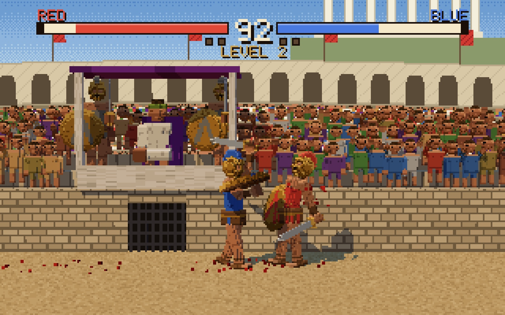

# Spartan Arena

A two-player fighting game on one keyboard. Two Spartan gladiators fight in a Roman arena in front of Caesar and a roaring crowd. They begin as unarmed beginners, earn a sword and shield, and finally share the sand with a lion or an elephant that attacks them both. Every model is made of stacked pixel-art voxel slices that you can repaint in any pixel editor.

The game was inspired by the classic arcade fighters, and the staging by the C64 karate games, with their painted landmark backdrops and a judge standing at the side. Everything here is original: the names, the art, the moves and the finishing move, *Caesar's verdict*.



## Controls

| | Red (left hand) | Blue (right hand) |
|---|---|---|
| Move | A, D | ←, → |
| Jump | W | ↑ |
| Crouch | S | ↓ |
| Punch (Level 1), sword slash (Levels 2–3) | F | `.` |
| Kick (crouch + kick = sweep) | G | `/` |
| Special: first reward card | H | Right Shift |
| Special: second reward card | S + H | ↓ + Right Shift |

- **Block** by holding away from your opponent. A crouching block stops low and mid attacks; a standing block stops mid and high attacks. A standing punch passes over someone who is crouching.
- **Charged strike:** with a sword, hold slash for a second after the swing, then release for a heavy overhead blow.
- **M** turns the sound on or off.

## The match

1. **Level 1: The Beginners.** No weapons, only fists and kicks.
2. **Level 2: Sword and Shield.** The punch becomes a sword slash, and blocking with the shield takes only 10% of the damage. Shield blocks use up stamina, which comes back after a second without blocking.
3. **Level 3: The Beasts.** Three seconds into each round, Caesar opens the gate. A lion comes out in rounds 1 and 3, an elephant in round 2.
   - The beast goes for whichever gladiator is nearest, and both gladiators can hit it.
   - Whoever kills it gets a cheer and 20 health back.
   - Kick or slash a lion: a standing punch passes over its back.
   - A normal jump can't clear the elephant, but the Leap of Sparta can.

Each level is best of three rounds. All three levels are always played, and whoever wins two levels is champion. When a round ends, Caesar turns his thumb down, and the winner has six seconds to walk up and strike: that's **Caesar's verdict**, and it takes the loser's sword arm. In Level 1 nobody has a sword, so Caesar throws a gladius into the sand for the winner to pick up.

### Arms

- Sword blows wound arms. Mid-height blows wound the shield arm, high blows wound the sword arm, and a blocked sword blow nicks the shield arm. Fists, kicks and beasts never wound arms.
- A **charged strike** that lands on a badly wounded arm (60 or more) cuts it off in the middle of the fight. It hits the shield arm if the defender is blocking, and the sword arm otherwise.
- Losing the shield arm means only plain blocks, at 50%. Losing the sword arm means no sword moves.
- Arms and health come back at the start of every round.

### Reward cards

After each level, three random cards are offered. The level's winner picks first, and the loser takes one of the other two. Cards you already own aren't offered again.

| Card | What it does |
|---|---|
| Sword throw | Hurls your sword (14 damage). You fight with fists until you walk over it to pick it up. |
| Leap of Sparta | Jumps twice as high. Press special in the air to stomp straight down (16 damage). |
| Fury fists | A five-hit flurry, 4 damage each. |
| Whirlwind kick | Spins all the way round and hits both sides (12 damage, knocks down). |
| Thunder blade | Every sword hit you land charges it by 20. When full, a blast of light does 25 damage, and blocking it only halves the damage. |
| Shield bash | Charges forward shield first: 6 damage and a half-second stun. |

## Run it locally

The page loads its voxel art from PNG files. A browser won't let a page opened straight from disk read the pixels of those files, so run a small web server from the **repository root**:

```bash
python3 -m http.server 8000
```

Then open <http://localhost:8000/game-spartan-arena/>. GitHub Pages serves it the same way: the repository has a `.nojekyll` file, so the files are published exactly as they are.

## Editing the voxels

Every model is built from body parts, and each part is one PNG in `voxels/<model>/<part>.png`. Repaint them in any pixel editor and reload the page.

- **Format:** a sheet holds 15 slices side by side in one row, so a part whose slices are *w*×*h* is a (15·*w*)×*h* PNG.
- **Slice 0** (the leftmost) is the one nearest the camera. Slice 14 is the furthest back.
- **Every slice is a side view** of a model facing right. Stacked front to back, the slices give the model its thickness.
- **A fully transparent pixel is empty** (alpha below 128); every other pixel becomes a voxel of that colour.
- **Team colours:** draw the gladiators in the red team's shades: `#a02424`, `#d03a30` and `#f06a50`. The blue team swaps exactly those three colours for blue, and Caesar's guards swap them for grey. Spectators are drawn with grey tunics (`#8c8c8c`, `#bcbcbc` and `#e4e4e4`), which each spectator swaps for a colour of their own.
- **Pivots and sizes** live in the rig table `SA.MODELS` in `index.html`, not in the images, so repainting can't break the skeleton. If you change a part's size, change its `w` and `h` there too. Running `node test.mjs` then checks every PNG's size, and the page itself lists any sheet with the wrong size.
- **First drafts:** `node tools/make_art.mjs` drew the first versions of all the art. Running it again keeps every PNG that already exists and fills in only missing ones. `node tools/make_art.mjs --force` redraws everything, and that overwrites your edits.
- **Backdrop:** `backdrop.png` (640×200) is the painted background behind the stands: the far crowd, the arches, the temple and the sky.

## Music

Drop a song named `music.mp3` next to `index.html` and it loops behind the fight. M mutes it along with the sound effects. Until the file exists, the browser console shows one harmless 404 for it. The sound effects (hits, clangs, crowd, lion roar, elephant trumpet, the gate) are synthesised with Web Audio.

## Tuning numbers

At 60 ticks per second:

| | |
|---|---|
| Health | 100 per round, a round lasts 99 s |
| Punch / kick / sweep | 5 / 7 / 6 (the sweep knocks down) |
| Slash / jump slash / charged strike | 10 / 11 / 22 |
| Plain block / shield block | takes 50% / 10%; a shield block costs 12 stamina |
| Arm wounds | +25 per sword blow, +10 per blocked sword blow; a charged strike chops at 60 |
| Lion | 60 health; claw 8, pounce 12 |
| Elephant | 140 health; trunk 10 with a toss, charge 18 with a knockdown |
| Jump / leap | peaks at about 45 / 91 voxels (a gladiator is 54 tall, the elephant 56) |

## Testing and review

```bash
node test.mjs
```

This runs the tests built into `index.html`: the slice mesher, the rig table, input, movement, combat, arms, the match flow and draft, every reward card and the beasts. It also plays a random brawl through a whole match, and checks the size of every PNG.

URL parameters for reviewing:

| Parameter | Effect |
|---|---|
| `?level=2&round=1` | starts straight into a fight |
| `?phase=draft`, `?phase=salute`, `?phase=champion` | opens that screen |
| `?seed=7` | fixes the random seed |
| `?demo=1` | a bot plays both sides |
| `?shot=440&bare` | fast-forwards 440 ticks before the first frame and hides the DEMO label (for screenshots) |
| `?pose=slash&t=8` | freezes Red in a pose |
| `?view=gladiator&level=2&team=1` | model viewer; also `lion`, `elephant`, `caesar`, `spectator`. Keys 1–9 pick test poses, Space stops the turning |
| `?view=arena` | the arena alone. C changes the crowd's mood, T Caesar's thumb, G opens the gate |

`window.__sa` exposes `match`, `step(n)` and `render()` for driving the game from the console.

This experiment is an `index.html` plus a folder of PNGs, not a single self-contained page, so that the art stays editable.
